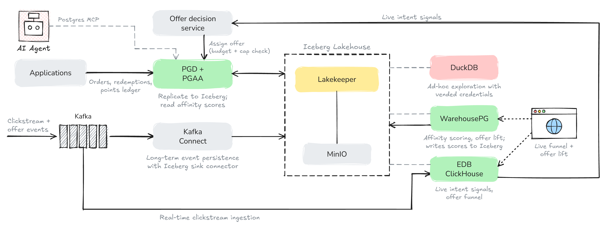

# Kestrel Market — Converged Analytics Demo (QD3M)

A runnable, local demonstration of **real‑time, personalised loyalty offers** on
**EDB Postgres AI / Converged Analytics**. A fictional omnichannel retailer,
*Kestrel Market*, decides and delivers an offer **while the shopper is still
browsing**, then measures whether it worked — all over **one copy of the data in
Apache Iceberg**, with no bespoke pipelines between engines.

The demo follows the **QD3M** loop:

| Phase | Question | Engine(s) |
|---|---|---|
| **Qualify** | Who deserves this offer? | PGAA over Iceberg (WarehousePG in production) |
| **Discover / Decide / Deliver** | What do they need *right now*? | EDB ClickHouse + PGD |
| **Measure** | Did it work? | ClickHouse (live) + PGAA (lift) |



> **Kestrel Market is fictional and all data is synthetic.** This is a
> demonstration of the architecture, not a benchmark or a product.

---

## What you'll see

- **A storefront** (`http://localhost:8080/`) where a shopper browses chilled
  desserts; their live clicks stream through Kafka, and a **personalised offer is
  decided in ~60 ms** by a single ClickHouse query that combines the live session
  with the governed audience and guardrails read from Iceberg. The offer is
  recorded back into Postgres and redeemed in one transaction.
- **A marketing dashboard** (`/marketing`) with a live conversion funnel
  (ClickHouse) and campaign **lift by region** (read from Iceberg), updating as the
  shopper checks out.
- **CLI walkthroughs** per engine (psql, clickhouse‑client, Kafka console, DuckDB)
  — see [`SHOOTING_SCRIPT.md`](SHOOTING_SCRIPT.md) and [`scenes/`](scenes/).

Every number on screen is measured in *your* environment; nothing is faked.

---

## Prerequisites

- **Docker** (Docker Desktop or Engine) with **~16 GB** of memory allocated and
  ~15 GB free disk. **Apple Silicon is supported** — the EDB images are amd64 and
  run under emulation (first build is slow; see [Notes](#notes--known-limitations)).
- **An EDB subscription token** (free) — used only to *build* the PGD/PGAA image
  from EDB's package repositories. Everything else uses public images.

### Get a free EDB token

1. **Create a free EDB account.** Go to **[enterprisedb.com](https://www.enterprisedb.com/)**
   and sign up (EDB Postgres AI). A free account is enough for this demo.
2. **Open your repository token.** In your EDB account, find **EDB Repos 2.0 /
   repository access** (sometimes shown as your "repos token" on the downloads or
   account page). Copy the token string.
3. **Put it in `.env`:**
   ```bash
   cp .env.example .env
   # edit .env and paste your token:
   #   EDB_SUBSCRIPTION_TOKEN=<your-token>
   ```

The token is read as a Docker **build secret** and is never baked into an image or
committed — `.env` is git‑ignored.

---

## Quick start

```bash
git clone <this-repo-url> kestrel-market-demo
cd kestrel-market-demo

cp .env.example .env          # paste your EDB token into .env

make build                    # build images (PGD/PGAA from EDB repos — slow the first time)
make up                       # start the stack + the demo-app UI
make setup                    # create Iceberg tables, register sink connectors, seed + replicate PGD
make reset                    # deterministic clean state (builds the audience + funnel)
make lift                     # compute regional lift (for the marketing dashboard)
```

Then open **http://localhost:8080** — the **storefront** at `/` and the **marketing
dashboard** at `/marketing` (toggle with the pill in the top‑right).

**Try the shopper flow:** browse a couple of dessert tiles, hit **↕ Price**, then
**Add** one to the basket — a personalised offer appears a few seconds later. Click
**Apply offer**, then **Checkout & redeem**. Switch to **Marketing** to watch the
funnel tick up and see the regional lift.

> Run `make reset` before each run‑through — the per‑member frequency cap needs a
> clean slate to hand out a fresh offer, and reset also keeps the data fresh.

---

## The engines, and how they share one copy of the data

| Component | Role | Reads / writes Iceberg |
|---|---|---|
| **EDB PGD + PGAA** | System of record (offers, members, orders, redemptions, points). | PGAA **replicates** these tables into Iceberg. |
| **Lakekeeper + MinIO** | Apache Iceberg REST catalog + object storage. | The single shared source of truth. |
| **Kafka + Kafka Connect** | Clickstream + engagement events. | The Iceberg sink **writes** events in. |
| **EDB ClickHouse** | Hot serving tier + the one‑query decision + live funnel. | **Reads** Iceberg; writes decisions to PGD via the PostgreSQL engine. |
| **WarehousePG + PGAA** | Batch audience + lift (the Qualify/Measure engine). | **CTAS** writes results to Iceberg *(see note below)*. |
| **DuckDB** | A neutral, non‑EDB engine, to show the lakehouse is open. | **Reads** Iceberg via `make duckdb`. |

Data lands in Iceberg via three write paths (PGAA replication, the Kafka sink, and
PGAA CTAS) and every engine reads it — no engine‑to‑engine pipelines.

---

## Useful make targets

```
make help          # list everything
make up / down     # start / stop the stack (keep volumes)
make down-v        # stop and WIPE volumes (full reset)
make setup         # one-time: event tables, connectors, seed + replicate
make reset         # between runs: reseed PGD, clear hot tables, rebuild audience + funnel
make audience      # build the campaign audience (PGAA CTAS → Iceberg)
make lift          # compute lift by region (north is deliberately weakest)
make duckdb        # neutral-engine lakehouse walkthrough (prints copy-paste queries)
make bench-decide  # measure the decision-query latency (min/median/p95)
make psql          # psql into PGD
make ch            # clickhouse-client
make up-whpg       # start the optional WarehousePG cluster
make status        # container health
```

A full, scene‑by‑scene walkthrough with every CLI command is in
[`SHOOTING_SCRIPT.md`](SHOOTING_SCRIPT.md); ready‑to‑paste SQL is in
[`scenes/cli/`](scenes/cli/).

---

## Repository layout

```
catalog/         MinIO + Lakekeeper (Iceberg REST catalog)
pgd/             EDB PGD + PGAA — system of record (schema, seed-time SQL, redemption)
kafka/           Kafka (KRaft) + topic creation
kafka-connect/   Kafka Connect worker + the Iceberg sink connectors (JSON)
event-generator/ Clickstream + engagement generator (history / live / hero modes)
clickhouse/      ClickHouse config, hot tables, and the decision / funnel queries
whpg/            WarehousePG cluster + audience / lift SQL (optional; see notes)
verifier/        Python toolbox: deterministic seed, setup, audience/lift builders
duckdb/          Neutral DuckDB CLI for the lakehouse walkthrough
common/          Shared deterministic "universe" (ids + built-in signal)
demo-app/        The storefront + marketing UI (React) and its FastAPI backend
scenes/          Recording scripts and ready-to-paste CLI SQL
docker-compose.yml  Root project (merges every component with `include:`)
Makefile         The interface
demo-config.toml    Single source of local config (names, local dev credentials)
DESIGN_NOTES.md     Verified EDB API facts, measured numbers, and design decisions
SHOOTING_SCRIPT.md  A 15-minute walkthrough script with the real commands
```

---

## Notes & known limitations

This is a **laptop‑friendly demo**, optimised to run reliably in front of people —
not production architecture. Some deliberate simplifications:

- **Apple Silicon / emulation.** The EDB images (PGD/PGAA, WarehousePG) are amd64
  and run under emulation on arm64. First build is slow. ClickHouse is pinned to
  `25.10` with JIT compilation disabled for arm64 stability — details and the full
  reasoning are in [`DESIGN_NOTES.md`](DESIGN_NOTES.md).
- **WarehousePG is optional and off the critical path.** It's the *intended* engine
  for the Qualify/Measure batch work, but the prebaked WarehousePG base used here is
  **7.4**, whose PGAA (1.9.1) creates the Iceberg table on CTAS but writes **no
  data**; coordinator‑side PGAA CTAS writes require **WarehousePG 7.6+** (no public
  image — build from source). So the audience and lift CTAS run on **PGD's PGAA**
  (which writes Iceberg correctly), and `make up` does not start WarehousePG. The
  architecture is identical; see [`DESIGN_NOTES.md`](DESIGN_NOTES.md) for the full
  investigation.
- **Tiered tables → plain replication.** The design allows PGAA tiered tables, but
  this build uses plain analytics replication (tiering offloaded too slowly under
  emulation).
- **Budget is read, not reserved.** The decision query reads remaining budget; it
  doesn't lock it. Fine for one shopper at a time.
- **First Iceberg sink commit** after a cold start takes ~90 s, then ~10 s.
- **Local credentials.** `demo-config.toml` contains credentials like
  `minioadmin`/`minioadmin` and `secret` — these are **local Docker defaults for
  services bound to localhost only**, not secrets. Change them if you expose any
  port beyond your machine.

---

## Troubleshooting

- **Build fails to find the EDB packages** → your token is missing or wrong. Check
  `EDB_SUBSCRIPTION_TOKEN` in `.env`.
- **Docker runs out of memory / containers get killed** → raise Docker's memory to
  ~16 GB.
- **The offer doesn't appear in the storefront** → run `make reset`, reload, and
  browse a couple of items *before* adding to the basket (so there's live intent),
  then wait a few seconds.
- **`make reset` says a table can't be found / stale catalog** → `make down-v && make up && make setup && make reset` for a clean rebuild.

---

## License

See [`LICENSE`](LICENSE). *(The included MIT license is a sensible default for a
demo — review and replace it with whatever your organisation requires before
publishing.)*

## Credits

Built as a demonstration of **EDB Postgres AI — Converged Analytics**. "Kestrel
Market" is fictional; all data is synthetically generated. Uses open‑source engines
and the open Apache Iceberg table format throughout.
